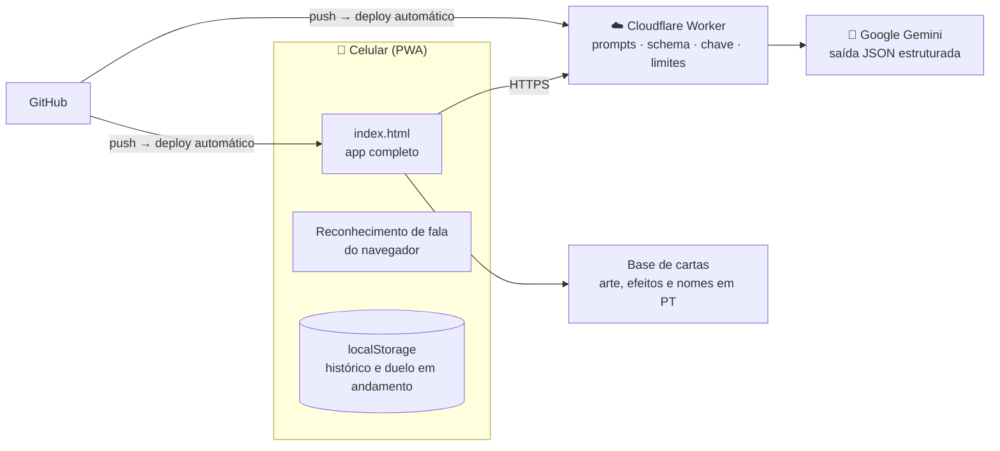

# 🔮 DuelDisk: companheiro de mesa com IA para Yu-Gi-Oh!

[](https://github.com/jvnunes1409/duel-disk/actions/workflows/testes.yml)

**[▶️ Abrir a demonstração](https://jvnunes1409.github.io/duel-disk/?demo)** (com o histórico real dos nossos duelos; nada é salvo no seu navegador) · **[Abrir o app](https://jvnunes1409.github.io/duel-disk/)** · funciona no navegador do celular e pode ser instalado como app (PWA)

Eu e meu sobrinho Douglas jogamos Yu-Gi-Oh! com cartas físicas e uma coleção de 28 decks. O DuelDisk começou como um contador de pontos de vida com sorteio e virou o companheiro de mesa dos nossos duelos: sorteia os decks de forma justa, conta o LP, organiza ligas e torneios, guarda o histórico e explica a estratégia de cada deck. Tem também um **Oráculo de IA** que prevê cada duelo, ouve as jogadas faladas e, no fim, explica se o resultado "deu a lógica".

<!-- Prints: docs/duelo.png, docs/previsao.png, docs/placar.png, docs/chaveamento.png -->

---

## Como nasceu

Com mais de 20 decks na coleção, o sorteio do duelo era um ritual improvisado: alguém de casa escolhia dois números de 1 a 24, contávamos os decks na estante e jogávamos com os que saíam. O processo era lento e, pior, injusto. Muitas vezes caía um deck muito forte contra um já ultrapassado, e o duelo estava decidido antes de começar.

Os outros problemas vinham depois do sorteio:
- **Controle:** os apps de contador de LP disponíveis eram genéricos e pouco atraentes, e não existia um lugar para guardar o histórico dos duelos.
- **Conhecer os decks:** a cada deck novo comprado, faltava tempo para abrir as cartas físicas e estudar a estratégia. Um app que mostra a lista de cartas, a estratégia principal e as cartas-chave resolve isso na hora.
- **Motivação:** ligas, torneios e estatísticas dão um objetivo para cada duelo e deixam o jogo mais divertido.

Precisávamos de algo feito para a nossa necessidade específica. Pegamos um problema nosso e resolvemos com a ajuda da IA, tanto no desenvolvimento quanto dentro do próprio app. O resultado foi além de um contador com sorteio: virou uma combinação de recursos que não encontramos em nenhum outro app, e que continua melhorando a cada duelo. O próximo passo é registrar cada jogada da partida.

## O problema que a IA resolve

Num duelo casual de cartas físicas, nada fica registrado. Não dá para saber quais decks são mais fortes de verdade, se a nossa divisão em tiers faz sentido, nem aprender com os erros de um duelo. A pergunta que guiou a parte de IA do projeto foi:

> **Uma IA consegue prever e explicar duelos melhor do que a nossa própria intuição sobre os decks? E como provar isso?**

## O que o app faz

| Área | Funcionalidades |
|---|---|
| **Sorteio** | Sorteio de decks em "modo justo" (diferença máxima de 1 tier) ou total, sem repetir decks recentes |
| **Duelo** | Contador de LP com teclado numérico, turnos, moeda, dado, sons e animações no estilo do anime |
| **Torneio** | Todos os 28 decks: preliminar, mata-mata, fase de grupos, semifinais e final, com chaveamento visual estilo Copa do Mundo; os campeões ganham 🏆 |
| **Histórico** | Todos os duelos com decks, duração, LP final e registro de dano; estatísticas em abas (jogadores, decks, tiers, Oráculo) e ranking Elo por deck |
| **🔮 Oráculo** | Previsão antes do duelo, jogadas por voz, crônica narrada e veredito depois do duelo |

## Como a IA é usada

### 1. Previsão antes do duelo
No instante do sorteio, o app manda para a IA os dois decks com **todas as cartas**: nome em português, nome em inglês, tipo, ATK/DEF e efeito resumido. Junto vão a estratégia de cada deck e o histórico do confronto (Elo e confronto direto). A IA devolve, em **JSON com schema definido**:
- a chance de vitória de cada lado e o nível de confiança;
- uma análise do confronto: ritmo, interações entre cartas e o que costuma decidir;
- o plano de jogo de cada deck e as cartas-chave, com o motivo de cada uma;
- como o deck menos favorito pode virar.

**Consistência calculada, não "achada":** Yu-Gi-Oh! depende muito da mão inicial. A IA lê os efeitos e marca, uma vez por deck, as **cartas de partida** (as que sozinhas já colocam a estratégia para andar) e os **tijolos** (as que travam a mão). Com isso, o app faz a **conta exata** (distribuição hipergeométrica): a chance de abrir com pelo menos uma carta de partida com 5 e com 6 cartas na mão, e a chance de vir com 2 ou mais tijolos. Esses números vão para a previsão como fatos. Cada um faz o que faz melhor: o modelo entende texto, o código faz conta.

**Regra anti-trapaça:** a previsão só vale se chegar **antes do primeiro dano**. Se alguém mexer no LP antes, ela é descartada, para a IA nunca "ver" o duelo começando.

### 2. Jogadas por voz, sem modelo de linguagem
Um toque no 🎙️ e você fala a jogada: *"ataquei com a Distopia e ele ativou a Lança dos Cavaleiros Fantasmas"*. O reconhecimento de fala é o do próprio navegador. A identificação das cartas é um **algoritmo determinístico**, não uma IA:
- procura só entre as ~100 cartas dos dois decks do duelo, e não entre as mais de 12 mil existentes;
- usa similaridade de texto (Levenshtein) com **peso por raridade das palavras**: "Cavaleiros Fantasmas" aparece em quase todo o deck e vale pouco, enquanto "Véu Sombrio" identifica a carta;
- divide a fala em ações ("e", "depois", "em resposta") e reconhece **várias cartas por frase**, marcando de qual deck é cada uma;
- palavras genéricas do jogo ("monstro", "armadilha") nunca identificam uma carta sozinhas.

**Por que não usar um modelo de linguagem aqui?** Precisa responder na hora, funcionar sem internet e não custar nada por jogada. Uma busca restrita e bem ponderada resolve melhor.

### 3. Crônica e veredito depois do duelo
A IA recebe o registro exato de LP (dano, turno, minuto), as jogadas faladas com o efeito de cada carta e a previsão feita antes. Com isso ela devolve:
- **Crônica:** a narração do duelo.
- **Veredito:** deu a lógica, foi zebra ou era equilibrado? Por quê? O que decidiu? E uma lição para cada jogador, apontando jogadas que funcionaram e possíveis erros.

O prompt proíbe inventar jogadas: o que não está no registro precisa ser apresentado como dedução ("provavelmente…").

## Como a IA é avaliada

Uma IA que soa convincente não é necessariamente uma IA que acerta. Por isso, cada previsão é comparada com o resultado real e com **três métodos simples**:

| Método | O que é |
|---|---|
| 🔮 **Oráculo (IA)** | Chance estimada pelo modelo antes do duelo |
| 📈 **Elo** | Sistema de pontuação do xadrez, calculado com os nossos resultados |
| 🏷️ **Tier** | Só a nossa classificação manual dos decks |
| 🪙 **Moeda** | 50% sempre; a referência mínima |

As métricas, em *Stats → 🔮 Oráculo*:
- **Acerto:** quem recebeu mais de 50% venceu?
- **Brier score:** erro quadrático da probabilidade (menor é melhor; 0,25 equivale a chutar 50%). Ele pune a IA que diz "90%" e erra mais do que a que diz "60%" e erra.
- **Calibragem:** quando a IA diz 70%, ela acerta cerca de 70% das vezes?

Com menos de 15 duelos o app avisa que a diferença entre os métodos ainda pode ser sorte.

<!-- Resultados: preencher com os números do Placar do Oráculo antes da apresentação -->

## Testes automáticos

Cada mudança enviada ao GitHub dispara **26 testes automáticos** (GitHub Actions). Eles abrem o app num navegador invisível e testam também o Worker, com a internet simulada:

- **Voz:** as cartas são reconhecidas em português, várias por frase, com o dono certo, e palavras genéricas não viram carta.
- **Oráculo:** a previsão sai no sorteio e é **descartada se chegar depois do primeiro dano** (regra anti-trapaça); a consistência usa a fórmula exata e a classificação de cada deck é feita uma vez só.
- **Teste retroativo:** **nunca envia o resultado** para a IA e usa só os duelos anteriores no Elo.
- **Worker:** saída em JSON estruturado, nova tentativa e modelo reserva quando o Gemini fica sobrecarregado, bloqueio de outros sites e limite de pedidos.
- **Segurança:** a política de conteúdo (CSP) bloqueia scripts de outros sites, as respostas do Worker nunca expõem a chave, e um arquivo de backup malicioso não consegue injetar código no app, e o Worker recusa pedidos de outros sites (inclusive `localhost`, a menos que seja liberado).
- **Vitrine:** o modo demonstração não mistura com os dados de quem visita, e no PC o teclado controla o contador.
- **App:** duelo retomado após recarregar, lembrete de turno, contagem de cartas, chaveamento do torneio e regressões visuais que já aconteceram (como o estilo da chave "vazando" para a moeda).

Para rodar localmente: `npm install && npx playwright install chromium && npm test`.

## Arquitetura



**Decisões de engenharia:**
- **A chave da API nunca vai para o navegador.** Ela fica num Worker, que também guarda os prompts e valida a origem, o tamanho e a frequência dos pedidos.
- **Saída estruturada (JSON schema)** em vez de texto livre, para o app sempre conseguir mostrar a resposta.
- **Latência:** a previsão começa no toque do Sortear, antes da animação; o raciocínio do modelo é limitado; se o modelo principal passar de 45 segundos, o Worker troca automaticamente para um modelo leve.
- **Modelos mudam:** quando o modelo antigo foi descontinuado, bastou trocar uma variável no Worker; o app mostra o erro real em vez de um genérico "sem sinal".
- **Texto de fora nunca vira código:** tudo o que vem de arquivo de backup ou de deck cadastrado é limpo na entrada e escapado na hora de mostrar (defesa em duas camadas).
- **Contexto em português:** as cartas físicas são em português, então a IA recebe e cita os nomes oficiais em português.
- **Feito para o celular, apresentável no PC:** em telas largas o app vira uma coluna e ganha um painel com o roteiro "teste em 1 minuto"; o contador aceita o teclado.
- **Resiliência:** o duelo em andamento é salvo a cada 2 segundos, e se o navegador recarregar a aba, ele volta de onde parou. Sem internet, o app funciona normalmente, só sem o Oráculo.

## Limitações conhecidas

- O Oráculo só sabe o que foi registrado: LP e jogadas faladas. Ele não vê a mão nem o campo.
- O reconhecimento de voz depende do Chrome e do ambiente; nomes muito parecidos entre decks podem confundir.
- O histórico fica no celular. A sincronização entre aparelhos ainda não existe; há backup por arquivo.
- O freio de pedidos do Worker é por instância (simples, não distribuído).

## Próximos passos

- **IA rival jogando de verdade:** usar o motor de regras aberto da comunidade (ygopro-core) e deixar a IA só tomar decisões, num duelo digital com cartas escondidas.
- **Sincronizar o histórico** entre os celulares por um servidor próprio.
- **Mais dados:** com mais duelos, testar se a IA supera o Elo e ajustar os prompts com base nos erros dela.
- **Hospedagem no Cloudflare Pages com domínio próprio:** permite mandar a política de segurança (CSP) e outros cabeçalhos pelo servidor, o que o GitHub Pages não permite, e servir o app e o Oráculo no mesmo endereço. Fica para depois porque mudar de endereço exige levar o histórico salvo em cada celular.

## Estrutura do repositório

Sem etapa de build: o navegador carrega os arquivos na ordem em que aparecem no `index.html`.

```
index.html                  marcação das telas e ordem dos scripts
css/estilo.css              visual (tema escuro inspirado no Duel Disk do anime)
js/
  dados/decks.js            os 28 decks: tier, atributo, estratégia, pontos fortes e fracos
  dados/cartas.js           lista de cartas de cada deck (nome em português e em inglês)
  base.js                   configuração, jogadores e utilitários
  sorteio.js                sorteio justo, draft e roleta
  duelo.js                  contador de LP, turnos, fim do duelo
  duelo-salvo.js            retoma o duelo se a aba recarregar
  historico.js, backup.js   histórico e backup
  estatisticas.js           estatísticas, conquistas e Elo
  torneio.js, liga.js       torneio com preliminar e liga de pontos corridos
  chaveamento.js            chave visual do torneio
  ia/oraculo.js             previsão, crônica e placar da IA contra Elo, tier e moeda
  ia/consistencia.js        chance de a mão inicial abrir jogando (IA classifica, o app calcula)
  ia/oraculo-historico.js   veredito depois do duelo
  ia/voz.js                 reconhecimento de cartas faladas (algoritmo próprio, sem IA externa)
  ...                       sons, artes, animações, dado e moeda, lista de cartas
worker/oraculo.js           Cloudflare Worker: prompts, schemas, limites e chamada ao Gemini
worker/wrangler.jsonc       deploy automático do Worker a cada push
sw.js                       service worker: funciona offline
icones/                     ícones do app instalado
.github/                    testes automáticos, varredura de segurança (CodeQL) e Dependabot
```

## Autoria e licença

Projeto criado e mantido por **[jvnunes1409](https://github.com/jvnunes1409)**. O histórico de commits registra a data e a autoria de cada mudança desde o primeiro dia.

O código está público **só para consulta e avaliação**: **todos os direitos reservados** (veja [LICENSE](LICENSE)). Não é permitido copiar o projeto nem apresentá-lo como trabalho próprio. Segurança: veja [SECURITY.md](SECURITY.md).

*Yu-Gi-Oh! e suas cartas pertencem à Konami; este é um projeto de fãs, sem fins comerciais.*
